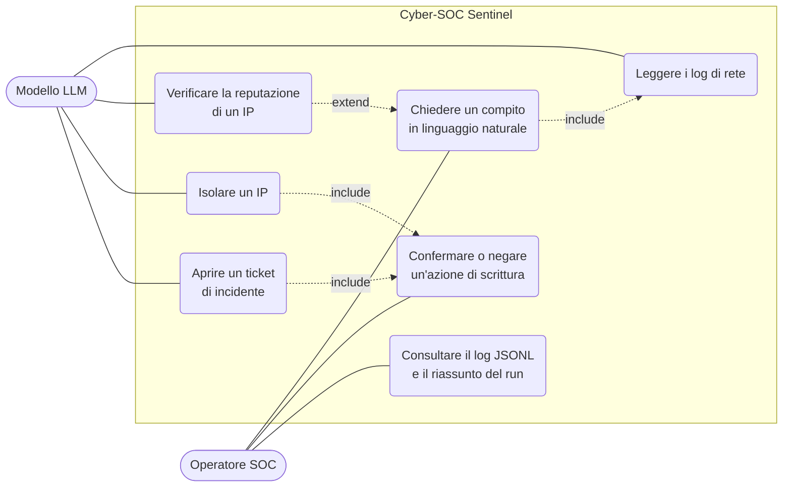
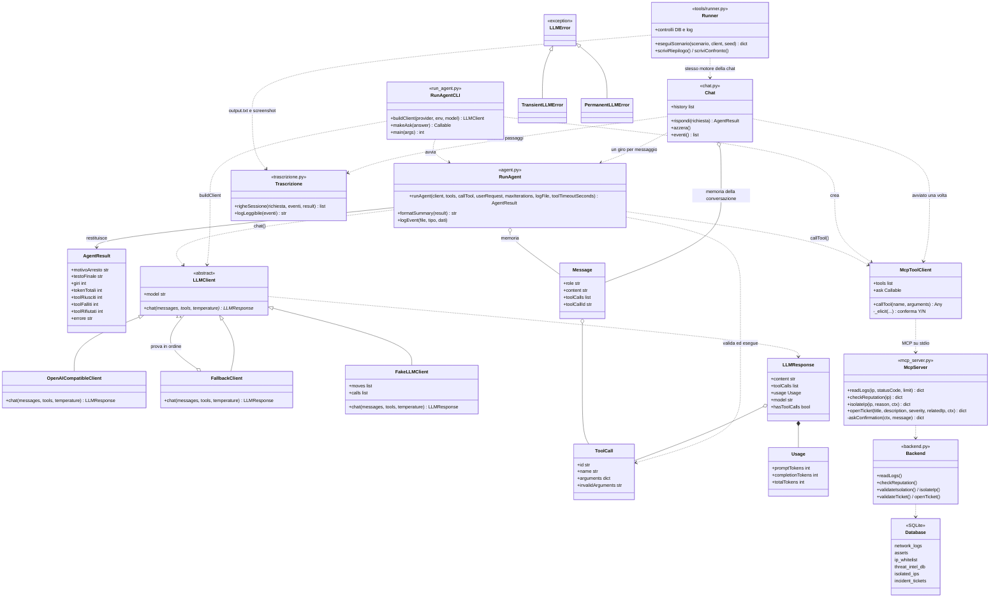
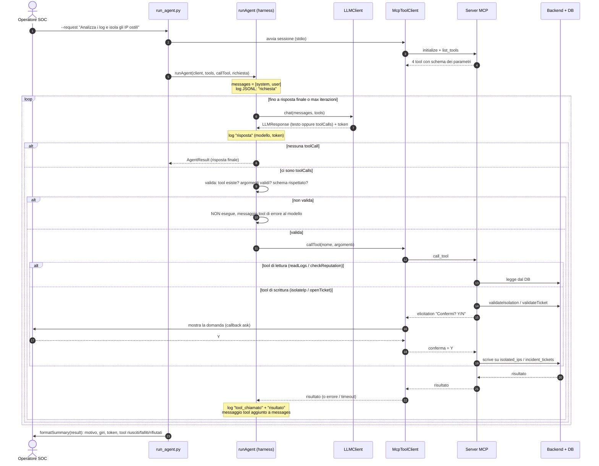
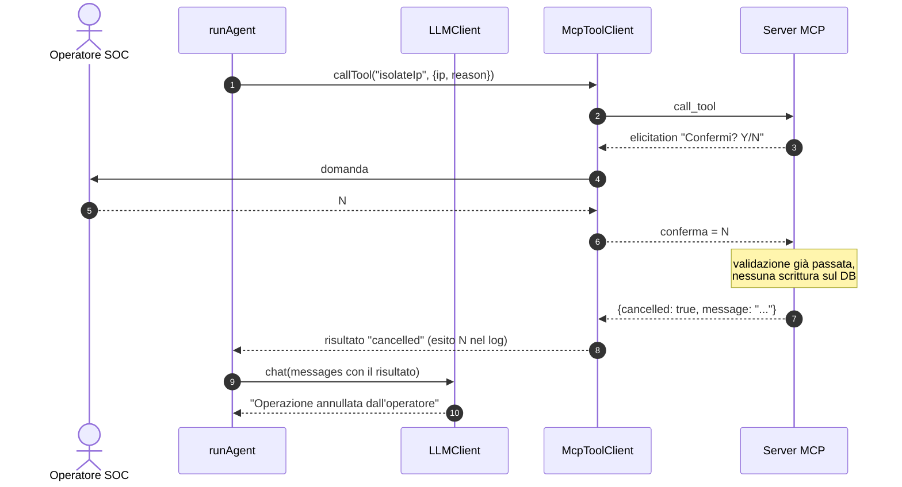

# Diagrammi UML

Tre diagrammi richiesti dalla traccia (PW 26), in Mermaid: si vedono su GitHub e
nell'anteprima Markdown di VS Code (`Ctrl+Shift+V`). Lo schema ER è in [er.md](er.md).

I nomi di classi, funzioni e file sono quelli del codice in `src/`.

---

## 1. Diagramma dei casi d'uso

L'operatore SOC chiede un compito in linguaggio naturale. Il modello (attore
secondario) sceglie i tool; le due azioni che scrivono sul DB passano per la
conferma Y/N dell'operatore.

**Come si legge.** L'operatore avvia il compito (`uc1`) e può rispondere alle
conferme (`uc6`) e rileggere il log (`uc7`). Il modello usa i quattro tool. Isolare
un IP e aprire un ticket **includono sempre** la conferma: senza un "Y" non si
scrive nulla (fail closed).

---

## 2. Diagramma delle classi (server MCP + harness)

Tre blocchi: **harness** (`agent.py`, `mcp_client.py`, `run_agent.py`), **livello
modello** (`llm/`, sostituibile senza toccare il resto) e **server MCP** con il
back-end.

**Punti chiave per la discussione.**
- `RunAgent` conosce solo l'interfaccia `LLMClient`: Gemini, Mistral, Ollama, il
  fallback e il finto per i test sono intercambiabili.
- `callTool` è passata da fuori: in test è un finto, in produzione è
  `McpToolClient.callTool`.
- La conferma Y/N parte dal **server** (`askConfirmation`, elicitation MCP) e
  l'harness la inoltra al callback `ask`: a mano `input`, in automatico `yes`/`no`.

---

## 3. Diagramma di sequenza: un ciclo agentico completo

Scenario: l'operatore chiede di analizzare i log e, se serve, isolare un IP. Si
vedono due giri con tool di lettura, poi la scrittura con conferma, poi la risposta
finale. Sotto, la variante con conferma negata.

### Variante: conferma negata

