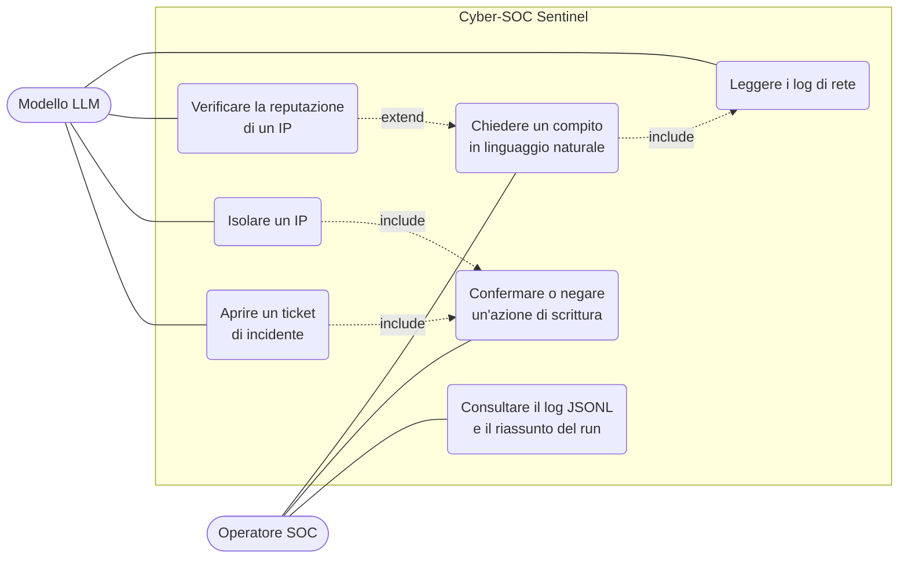
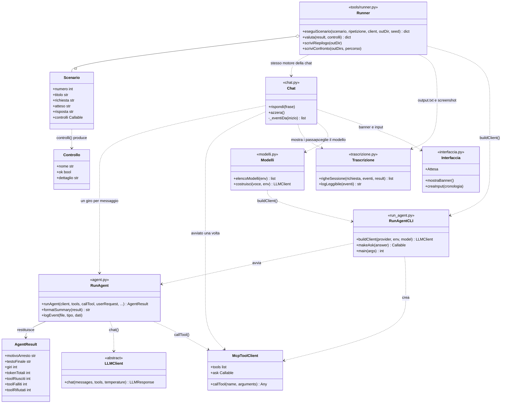
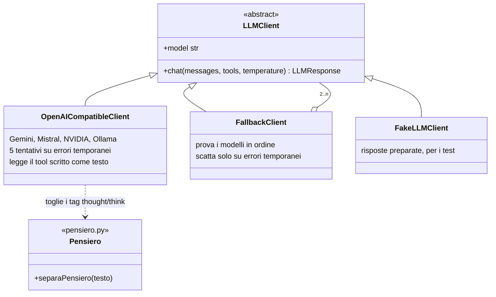
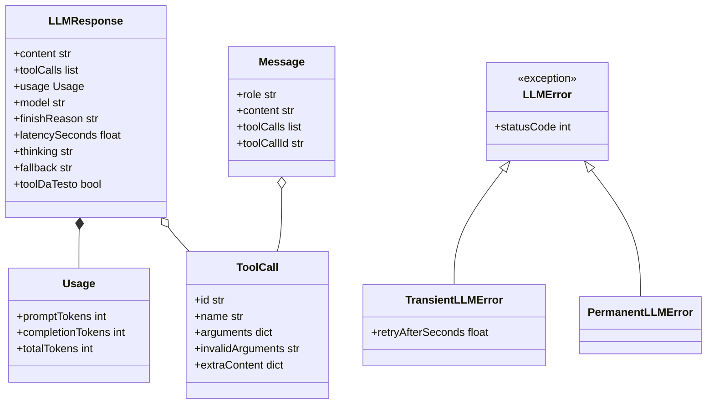
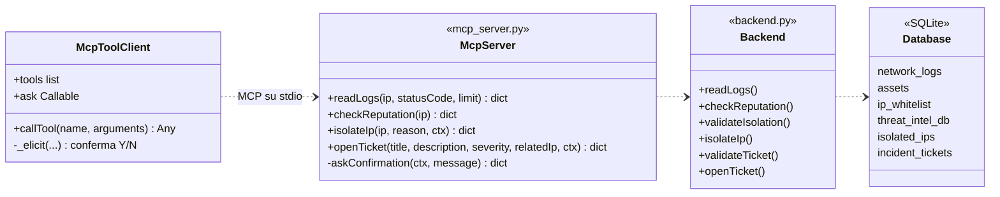
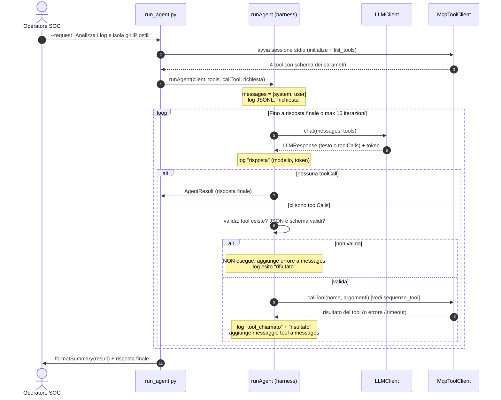
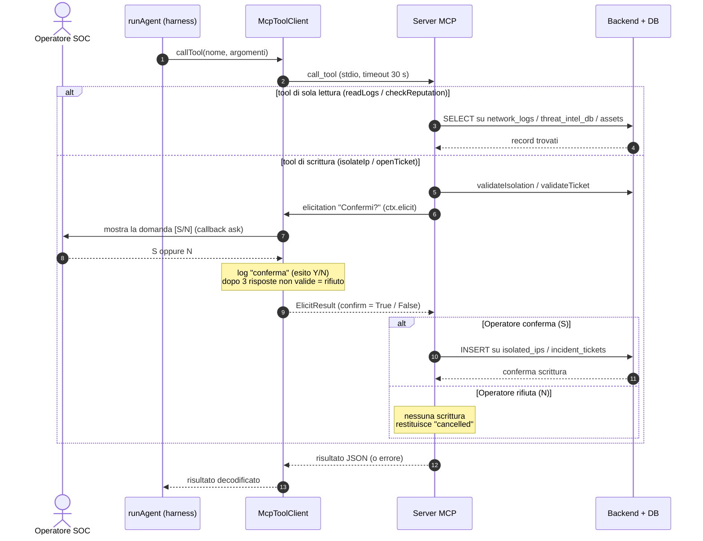
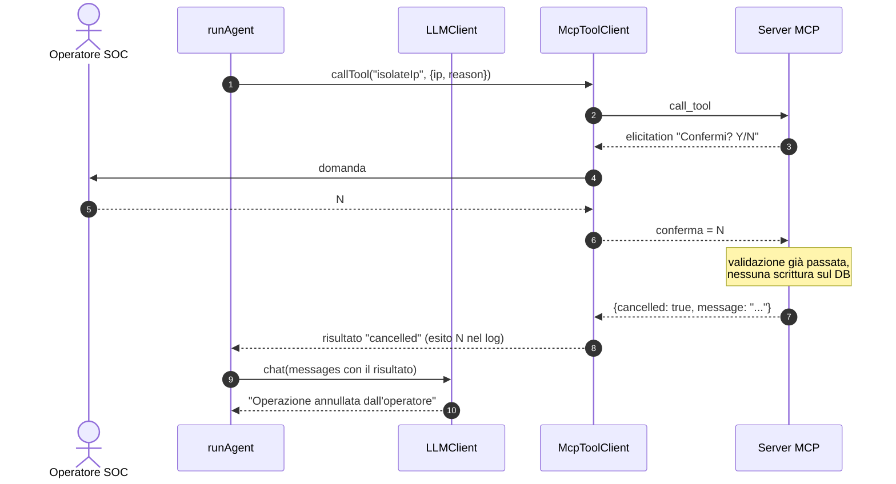

# Diagrammi UML

I diagrammi richiesti dalla traccia (PW 26), in Mermaid: si vedono su GitHub e
nell'anteprima Markdown di VS Code (`Ctrl+Shift+V`). Ogni diagramma ha il sorgente
`.mmd` e l'immagine `.png` in [`img/`](img/), con la stessa numerazione delle figure del
report. Lo schema ER (Figura 4) è in [er.md](er.md).

I nomi di classi, funzioni e file sono quelli del codice in `src/` e `tools/`.

| Figura | Cosa mostra | File in `img/` |
|---|---|---|
| 1 | Casi d'uso | `01_casi_uso` |
| 2a | Classi: harness (Runner, Chat, RunAgent) | `02a_classi_harness` |
| 2b | Classi: livello modello (client LLM) | `02b_classi_llm` |
| 2c | Classi: messaggi, risposte ed errori | `02c_classi_messaggi` |
| 2d | Classi: server MCP, back-end, database | `02d_classi_server` |
| 3a | Sequenza: il ciclo agentico (runAgent) | `03a_sequenza_ciclo` |
| 3b | Sequenza: esecuzione di un tool MCP e conferma umana | `03b_sequenza_tool` |
| 3c | Sequenza: variante con conferma negata | `03c_sequenza_conferma_negata` |
| 4 | Schema ER | [er.md](er.md) |

---

## Figura 1 — Diagramma dei casi d'uso

L'operatore SOC chiede un compito in linguaggio naturale. Il modello (attore
secondario) sceglie i tool; le due azioni che scrivono sul DB passano per la
conferma dell'operatore.

*Figura 1: sorgente [`img/01_casi_uso.mmd`](img/01_casi_uso.mmd), immagine [`img/01_casi_uso.png`](img/01_casi_uso.png).*

**Come si legge.** L'operatore avvia il compito (`uc1`) e può rispondere alle
conferme (`uc6`) e rileggere il log (`uc7`). Il modello usa i quattro tool. Isolare
un IP e aprire un ticket **includono sempre** la conferma: senza un sì esplicito non si
scrive nulla (fail closed).

---

## Figura 2 — Diagramma delle classi (server MCP + harness)

Tre blocchi: **harness** (`agent.py`, `mcp_client.py`, `run_agent.py`, `chat.py`, `tools/runner.py`),
**livello modello** (`llm/`, sostituibile senza toccare il resto) e **server MCP** con il
back-end. Il diagramma è diviso in quattro figure per restare leggibile.

### Figura 2a — Harness

*Figura 2a: sorgente [`img/02a_classi_harness.mmd`](img/02a_classi_harness.mmd), immagine [`img/02a_classi_harness.png`](img/02a_classi_harness.png).*

### Figura 2b — Livello modello

*Figura 2b: sorgente [`img/02b_classi_llm.mmd`](img/02b_classi_llm.mmd), immagine [`img/02b_classi_llm.png`](img/02b_classi_llm.png).*

### Figura 2c — Messaggi, risposte ed errori

*Figura 2c: sorgente [`img/02c_classi_messaggi.mmd`](img/02c_classi_messaggi.mmd), immagine [`img/02c_classi_messaggi.png`](img/02c_classi_messaggi.png).*

### Figura 2d — Server MCP, back-end e database

*Figura 2d: sorgente [`img/02d_classi_server.mmd`](img/02d_classi_server.mmd), immagine [`img/02d_classi_server.png`](img/02d_classi_server.png).*

**Punti chiave per la discussione.**
- `RunAgent` conosce solo l'interfaccia `LLMClient`: Gemini, Mistral, NVIDIA, Ollama, il
  fallback e il finto per i test sono intercambiabili (Figura 2b).
- `callTool` è passata da fuori: in test è un finto, in produzione è
  `McpToolClient.callTool`.
- La conferma parte dal **server** (`askConfirmation`, elicitation MCP) e l'harness la
  inoltra al callback `ask`: a mano `input` (risposte S/Y o N), in automatico `yes`/`no`.
- `Runner` e `Chat` usano lo stesso motore (`RunAgent`): i test non provano una copia
  del codice, ma quello che si usa a mano.

---

## Figura 3 — Diagramma di sequenza

Il ciclo agentico è diviso in due diagrammi da cinque colonne ciascuno, più la variante
con conferma negata. Il primo mostra cosa fa l'harness, il secondo cosa succede dentro un
tool.

### Figura 3a — Il ciclo agentico (`runAgent`)

Avvio della sessione, ciclo con al massimo 10 iterazioni, chiamata al modello,
validazione dei parametri prima di eseguire e delega a `callTool`.

*Figura 3a: sorgente [`img/03a_sequenza_ciclo.mmd`](img/03a_sequenza_ciclo.mmd), immagine [`img/03a_sequenza_ciclo.png`](img/03a_sequenza_ciclo.png).*

### Figura 3b — Esecuzione di un tool MCP e conferma umana

Cosa succede dentro `callTool`: il protocollo MCP con timeout di 30 s, il bivio tra tool di
lettura e di scrittura, la conferma S/N dell'operatore (dopo 3 risposte non valide vale come
rifiuto) e la scrittura sul DB solo se confermata.

*Figura 3b: sorgente [`img/03b_sequenza_tool.mmd`](img/03b_sequenza_tool.mmd), immagine [`img/03b_sequenza_tool.png`](img/03b_sequenza_tool.png).*

### Figura 3c — Variante: conferma negata

*Figura 3c: sorgente [`img/03c_sequenza_conferma_negata.mmd`](img/03c_sequenza_conferma_negata.mmd), immagine [`img/03c_sequenza_conferma_negata.png`](img/03c_sequenza_conferma_negata.png).*

---

## Figura 4 — Schema ER

Vedi [er.md](er.md): sei tabelle (`network_logs`, `assets`, `ip_whitelist`,
`threat_intel_db`, `isolated_ips`, `incident_tickets`).
