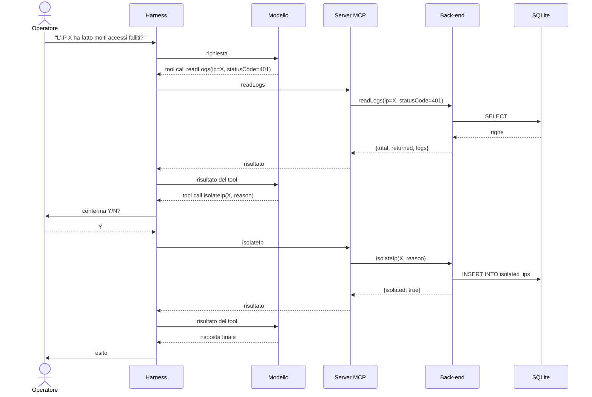

# Back-end: specifica tecnica

| | |
|---|---|
| **Modulo** | `src/backend.py` |
| **Test** | `tests/test_backend.py` (12 test automatici) |
| **Database** | SQLite, 6 tabelle (vedi [er.md](er.md)) |
| **Convenzioni** | Identificatori Python in camelCase; nomi di tabelle e colonne SQL invariati |

## 1. Scopo

La traccia richiede "un semplice back-end con base dati relazionale popolata con
dati sintetici". Il modulo `backend.py` è lo strato applicativo che incapsula
tutte le operazioni sui dati aziendali: lettura dei log di rete, verifica della
reputazione di un indirizzo IP, isolamento di un IP sospetto e apertura di
ticket di incidente.

Il modulo è indipendente dal modello linguistico e dal protocollo MCP. Può
essere eseguito e verificato in isolamento.

## 2. Collocazione architetturale


### Ripartizione delle responsabilità

| Componente | Responsabilità | Esclusioni |
|---|---|---|
| Back-end | Esegue le operazioni sul DB, valida i dati, restituisce un risultato o un errore strutturato | Non conosce il modello, il protocollo MCP né l'utente |
| Server MCP | Espone le quattro funzioni come tool con nome, descrizione e schema dei parametri | Non contiene logica sui dati |
| Harness | Gestisce il ciclo con il modello, richiede la conferma Y/N prima delle scritture, produce il log JSONL | Non accede direttamente al DB |
| Simulatore | Genera i dati sintetici per gli scenari di test | Non fa parte del sistema in esercizio |

## 3. Contratto delle funzioni

Tutte le funzioni accettano parametri semplici e restituiscono un dizionario
serializzabile in JSON. Non sollevano eccezioni verso il chiamante: ogni
anomalia viene restituita nella forma `{"error": "<messaggio>"}`.

### 3.1 `readLogs(ip=None, statusCode=None, limit=100)`

Operazione di **lettura** su `network_logs`.

| Parametro | Tipo | Descrizione |
|---|---|---|
| `ip` | stringa, opzionale | Indirizzo IPv4 da filtrare |
| `statusCode` | intero, opzionale | Codice di stato HTTP da filtrare (es. 401, 500) |
| `limit` | intero, default 100 | Numero massimo di righe restituite (massimo 500) |

**Risposta:** `{"total": n, "returned": m, "logs": [...]}`. I log sono ordinati
dal più recente. `total` indica le righe che soddisfano i filtri, `returned`
quelle incluse nella risposta: il chiamante può quindi rilevare un risultato
troncato da `limit`.

**Errori:** `Invalid IP`, `Invalid statusCode`, `Invalid limit`.

### 3.2 `checkReputation(ip)`

Operazione di **lettura** su `ip_whitelist`, `threat_intel_db` e `assets`.

**Risposta:**

| Campo | Significato |
|---|---|
| `ip` | Indirizzo richiesto |
| `whitelisted` | `true` se presente in whitelist |
| `whitelistReason` | Motivo della whitelist, altrimenti `null` |
| `threatScore` | Punteggio di minaccia (0-100), `null` se assente dal threat intel |
| `threatReason` | Motivo della segnalazione, altrimenti `null` |
| `assetName` | Nome dell'asset aziendale corrispondente, altrimenti `null` |
| `criticalAsset` | `true` se l'IP appartiene a un asset critico |

La funzione restituisce esclusivamente dati. La valutazione di pericolosità
spetta al modello.

**Errori:** `Invalid IP`.

### 3.3 `isolateIp(ip, reason, operator="soc-agent")`

Operazione di **scrittura** su `isolated_ips`.

| Parametro | Tipo | Descrizione |
|---|---|---|
| `ip` | stringa | Indirizzo IPv4 da isolare |
| `reason` | stringa | Motivazione dell'isolamento (obbligatoria) |
| `operator` | stringa, opzionale | Autore dell'operazione registrato in `operatore` |

**Risposta:** `{"isolated": true, "ip": "<ip>"}`.

**Errori:** `Invalid IP`, `Reason is required`, `IP already isolated`,
`Critical asset (<nome>): cannot be isolated`.

### 3.4 `openTicket(title, description, severity, relatedIp=None, relatedStatusCode=None)`

Operazione di **scrittura** su `incident_tickets`.

| Parametro | Tipo | Descrizione |
|---|---|---|
| `title` | stringa | Titolo del ticket (obbligatorio) |
| `description` | stringa | Descrizione dell'incidente (obbligatoria) |
| `severity` | stringa | `Bassa`, `Media` o `Alta` |
| `relatedIp` | stringa, opzionale | IPv4 correlato |
| `relatedStatusCode` | intero, opzionale | Codice di stato correlato |

**Risposta:** `{"ticketId": n, "status": "aperto"}`.

**Errori:** `Title is required`, `Description is required`,
`Invalid severity (use one of: Bassa, Media, Alta)`, `Invalid IP`,
`Invalid statusCode`.

### 3.5 Errore di database

Qualsiasi errore di `sqlite3` viene intercettato e restituito come
`{"error": "Database error: <dettaglio>"}`.

## 4. Regole di business

Le regole sono applicate dal back-end e non dal modello, in modo che restino
valide anche in caso di comportamento errato o manipolato dell'agente.

| Regola | Comportamento |
|---|---|
| Validazione IP | Solo stringhe IPv4 valide; ogni altro valore è rifiutato prima di qualsiasi accesso al DB |
| Asset critico | Un IP con `critico = 1` in `assets` non può essere isolato, anche se un testo iniettato nei log lo richiede (scenario 7). Il tentativo viene registrato nel log dall'harness |
| Isolamento duplicato | Il vincolo `UNIQUE` su `isolated_ips.ip` garantisce l'unicità anche in caso di richieste concorrenti |
| Gravità | Ammessi solo i valori del vincolo `CHECK` dello schema |
| Assenza di dati | Una ricerca senza risultati restituisce `total: 0`; il modulo non produce mai valori sostitutivi |

La whitelist (traffico legittimo, falsi positivi) e la criticità di un asset
sono concetti distinti: l'IP del server dell'agente SOC è registrato come
asset critico, non in whitelist.

## 5. Sicurezza e integrità dei dati

- **Query parametrizzate.** I valori ricevuti dal chiamante sono sempre passati
  come parametri (`?`), mai concatenati nelle istruzioni SQL. Poiché i
  parametri provengono dal modello, e quindi da testo non fidato, ciò
  previene la SQL injection.
- **Validazione dei tipi.** Valori booleani, stringhe vuote e numeri fuori
  intervallo sono rifiutati. Il valore `limit` è limitato a 500 per non
  saturare il contesto del modello.
- **Transazioni.** Le scritture avvengono in una transazione con commit in caso
  di successo e rollback in caso di errore.
- **Connessioni.** Ogni chiamata apre e chiude la propria connessione.

## 6. Ambiti esclusi

- **Conferma dell'operatore (Y/N).** È gestita dall'harness. Il back-end esegue
  l'operazione quando viene invocato.
- **Classificazione degli incidenti.** Il back-end restituisce fatti (ad
  esempio 50 accessi falliti); l'interpretazione spetta al modello.
- **Validazione dello schema JSON dei parametri.** È eseguita dall'harness
  prima della chiamata al server (scenario 9). Il back-end ripete i controlli
  essenziali come seconda linea di difesa.

## 7. Motivazioni della separazione dal server MCP

1. **Tracciabilità dei requisiti.** Il back-end è un componente richiesto dalla
   traccia e viene consegnato e documentato come codice autonomo.
2. **Verificabilità.** Le funzioni si testano su un database temporaneo, senza
   server MCP né modello linguistico.
3. **Semplicità del server MCP.** Ogni tool si riduce a una breve chiamata al
   back-end, con vantaggi per manutenzione e documentazione.

## 8. Esempio di flusso (scenario 2)



Ogni passaggio viene registrato nel log JSONL dell'harness.

## 9. Esecuzione dei test

Dalla cartella `cyber-soc-sentinel`:

```
python -m unittest tests.test_backend -v
```

I test usano un database temporaneo: `data/soc.db` non viene modificato.
