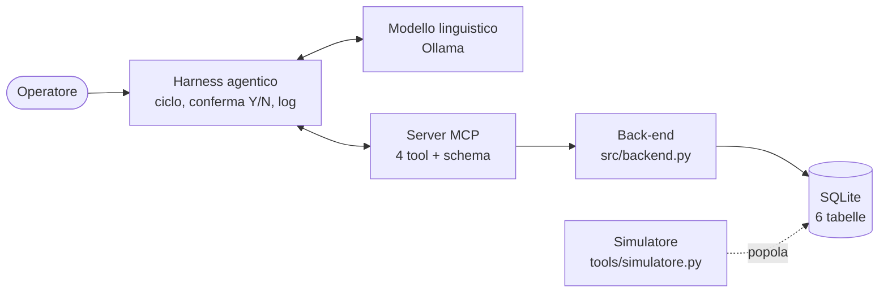

# Back-end — cosa fa e dove sta

La traccia chiede "un semplice back-end con base dati relazionale popolata con
dati sintetici". Qui il back-end è lo strato che **sa lavorare sui dati
aziendali**: legge e scrive il database, e nient'altro.

## Dove si colloca

Ognuno fa una cosa sola:

| Strato | Cosa fa | Cosa NON fa |
|---|---|---|
| **Back-end** | Esegue le operazioni sul DB, controlla che i dati siano validi, restituisce un risultato o un errore | Non conosce il modello, né MCP, né l'utente |
| **Server MCP** | Espone le 4 funzioni come *tool* con nome, descrizione e schema dei parametri | Non contiene logica sui dati: chiama il back-end |
| **Harness** | Guida il ciclo con il modello, chiede conferma prima delle scritture, scrive il log | Non tocca il DB direttamente |
| **Simulatore** | Prepara i dati degli scenari per i test | Non fa parte del sistema in esercizio |

## Cosa deve fare, in concreto

Quattro funzioni, una per tool. Ognuna riceve parametri semplici e restituisce
un dizionario (JSON), mai un'eccezione verso l'alto.

| Funzione | Legge/scrive | Cosa fa |
|---|---|---|
| `readLogs(ip=None, statusCode=None, limit=100)` | legge `network_logs` | Filtra i log per IP e/o codice, dal più recente, fino a `limit` righe. Restituisce `{"total": n, "returned": m, "logs": [...]}` |
| `checkReputation(ip)` | legge `ip_whitelist`, `threat_intel_db`, `assets` | Dice se l'IP è in whitelist, se è nel threat intel e con che score; indica se è un asset critico |
| `isolateIp(ip, reason)` | **scrive** `isolated_ips` | Controlla che l'IP sia IPv4 valido e non già isolato, poi inserisce la riga. Rifiuta gli asset critici |
| `openTicket(title, description, severity, relatedIp?, relatedStatusCode?)` | **scrive** `incident_tickets` | Controlla che `severity` sia Bassa/Media/Alta, poi inserisce il ticket |

## Le regole che il back-end fa rispettare

Queste regole stanno qui, non nel modello, perché devono valere **anche se il
modello sbaglia**:

- **IP non valido** (es. `999.999`) → `{"error": "IP non valido"}`, nessuna scrittura.
- **IP già isolato** → `{"error": "IP già isolato"}`.
- **Asset critico** (host amministrativo, server dell'agente SOC) → non si isola
  mai, anche se un testo iniettato nei log lo chiede (scenario 7). Il tentativo
  viene comunque registrato nel log dall'harness. L'IP dell'agente sta in
  `assets` con `critico = 1`: così non può isolare sé stesso e non serve codice
  speciale. La whitelist è un'altra cosa (traffico legittimo, falsi positivi).
- **Gravità fuori elenco** → `{"error": "Gravità non valida"}`.
- **Risultato mai inventato**: se non trova dati restituisce `total: 0`, non un
  valore plausibile.

## Cosa NON fa (e chi lo fa)

- **Chiedere la conferma Y/N**: è dell'harness. Il back-end esegue quando viene
  chiamato; sapere *se* chiamarlo dopo il "sì" dell'utente spetta all'harness.
- **Decidere cos'è un attacco**: lo decide il modello. Il back-end restituisce
  fatti (50 login falliti), non giudizi.
- **Validare lo schema JSON dei parametri**: lo fa l'harness prima di chiamare
  il server (scenario 9). Il back-end ripete i controlli essenziali come
  seconda difesa.

## Perché separarlo dal server MCP

1. **È la parte che la traccia chiama "back-end"** e va consegnata e descritta
   come codice a sé.
2. **Si testa da solo**: una funzione su un DB di prova, senza MCP né modello.
3. **Il server MCP resta sottile**: ogni tool è poche righe che chiamano il
   back-end, quindi facile da spiegare nel report ("almeno un tool").

## Esempio di flusso (scenario 2)

1. L'operatore scrive: "Controlla l'IP X: ha fatto molti accessi falliti?"
2. Il modello chiede `readLogs(ip=X, statusCode=401)` → l'harness lo inoltra al server MCP →
   il server chiama `backend.readLogs(...)` → risposta con 50 log.
3. Il modello propone `isolateIp`. **L'harness chiede Y/N.** L'operatore digita Y.
4. Il server MCP chiama `backend.isolateIp(X, reason)` → inserisce la riga in `isolated_ips`.
5. Il modello conferma all'operatore. Ogni passo finisce nel log JSONL.
