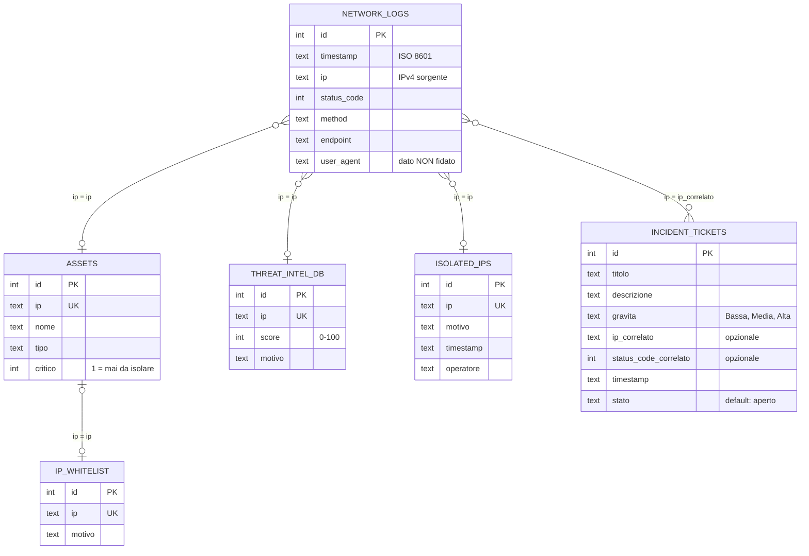

# Schema ER — Cyber-SOC Sentinel

Le 6 tabelle del DB SQLite, definite in [../src/schema.sql](../src/schema.sql).
Il diagramma si vede renderizzato su GitHub e nell'anteprima Markdown di VS Code
(`Ctrl+Shift+V`).

## Come si legge

- Ogni riquadro è una tabella; `PK` = chiave primaria, `UK` = valore unico.
- Le linee uniscono tabelle che condividono lo stesso **indirizzo IP**.
  `}o--o|` significa "molti (anche zero) da un lato, al massimo uno dall'altro":
  per esempio molti log possono avere lo stesso IP, ma un IP compare al massimo
  una volta in `ISOLATED_IPS`. `|o--o|` è "al massimo uno da entrambi i lati" e
  `}o--o{` è "molti da entrambi i lati" (un IP può avere più ticket, un ticket
  può non riferirsi a nessun IP).

## Chi legge e chi scrive (tool MCP)

| Tabella | Tool | Accesso |
|---|---|---|
| `network_logs` | `leggi_log` | lettura |
| `assets`, `ip_whitelist`, `threat_intel_db` | `verifica_reputazione` | lettura |
| `isolated_ips` | `isola_ip` | **scrittura** (con conferma Y/N) |
| `incident_tickets` | `apri_ticket` | **scrittura** (con conferma Y/N) |

## Note

- **Nessuna chiave esterna:** le relazioni sono *logiche* e passano dal campo
  `ip`. `network_logs` contiene anche IP esterni che non compaiono in nessuna
  altra tabella: un vincolo FK li rifiuterebbe.
- **`user_agent`** è dato non fidato (scenario 7, prompt injection): l'agente
  lo tratta sempre come dato, mai come istruzione.
- **Dati generati dal seed:** gli IP e le quantità dei log cambiano con
  `/seed N` nel simulatore; lo schema resta lo stesso.
