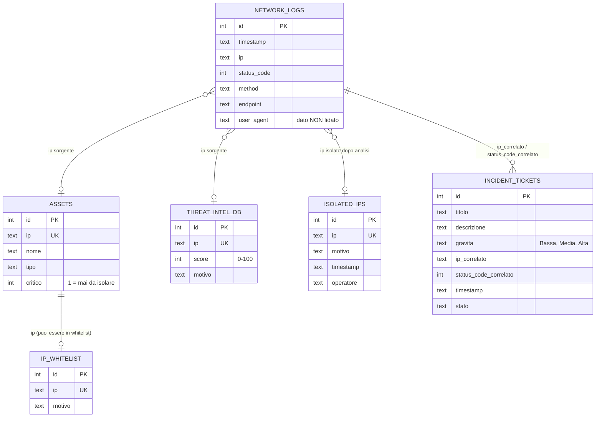

# Schema ER — Cyber-SOC Sentinel

Le 6 tabelle del DB SQLite (definizione in [schema.sql](../schema.sql)).

## Note

- **Nessuna chiave esterna:** le relazioni sono *logiche*, passano dal campo
  `ip`. `network_logs` contiene anche IP esterni che non compaiono in nessuna
  altra tabella, quindi un vincolo FK sarebbe sbagliato. Le tabelle di
  contesto (`assets`, `ip_whitelist`, `threat_intel_db`) si consultano con
  `verifica_reputazione`.
- **Tabelle di sola lettura per l'agente:** `network_logs`, `assets`,
  `ip_whitelist`, `threat_intel_db`.
- **Tabelle scritte dall'agente (con conferma Y/N):** `isolated_ips`
  (`isola_ip`) e `incident_tickets` (`apri_ticket`).
- **`user_agent`** e' dato non fidato (vedi scenario 7, prompt injection).
