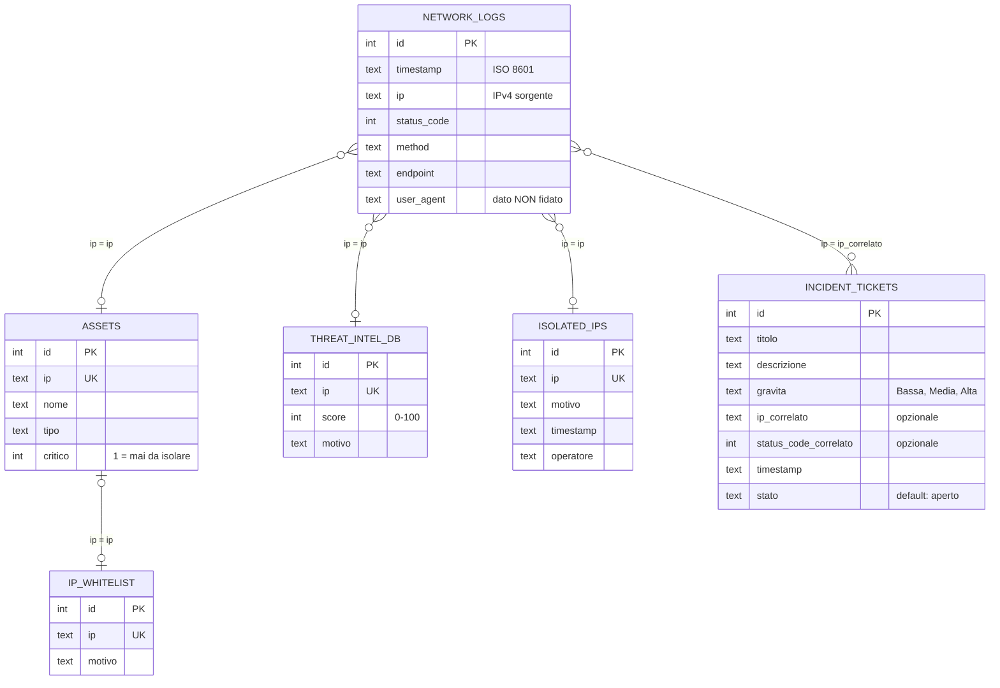

# Modello dei dati: schema ER

| | |
|---|---|
| **DBMS** | SQLite |
| **Definizione** | [src/schema.sql](../src/schema.sql) |
| **Tabelle** | 6 |
| **Popolamento** | Dati sintetici generati da `tools/simulatore.py` |

Il diagramma è visualizzabile su GitHub e nell'anteprima Markdown di VS Code
(`Ctrl+Shift+V`).

## 1. Diagramma

### Notazione

`PK` indica la chiave primaria e `UK` un vincolo di unicità. Le associazioni
collegano tabelle che condividono lo stesso indirizzo IP.

| Simbolo | Significato |
|---|---|
| `}o--o\|` | Molti (anche zero) da un lato, al massimo uno dall'altro. Esempio: più log possono riferirsi allo stesso IP, che compare al massimo una volta in `ISOLATED_IPS` |
| `\|o--o\|` | Al massimo uno da entrambi i lati |
| `}o--o{` | Molti da entrambi i lati. Esempio: un IP può avere più ticket, e un ticket può non riferirsi ad alcun IP |

## 2. Descrizione delle tabelle

| Tabella | Contenuto | Vincoli principali |
|---|---|---|
| `network_logs` | Richieste di rete registrate (data, IP sorgente, metodo, endpoint, codice di stato, user agent) | Indici su `ip` e `status_code` |
| `assets` | Asset aziendali noti | `ip` univoco; `critico = 1` indica un asset da non isolare mai |
| `ip_whitelist` | Indirizzi con traffico legittimo | `ip` univoco |
| `threat_intel_db` | Indirizzi noti come pericolosi, con punteggio | `ip` univoco; `score` tra 0 e 100 |
| `isolated_ips` | Indirizzi isolati, con motivo, data e operatore | `ip` univoco |
| `incident_tickets` | Ticket di incidente | `gravita` limitata a Bassa, Media, Alta; `stato` predefinito `aperto` |

## 3. Accesso da parte dei tool MCP

| Tabella | Tool | Accesso |
|---|---|---|
| `network_logs` | `readLogs` | Lettura |
| `assets`, `ip_whitelist`, `threat_intel_db` | `checkReputation` | Lettura |
| `isolated_ips` | `isolateIp` | Scrittura (con conferma Y/N) |
| `incident_tickets` | `openTicket` | Scrittura (con conferma Y/N) |

`assets` è letta anche da `isolateIp` per rifiutare l'isolamento degli asset
critici (vedi [backend.md](backend.md)).

## 4. Scelte di progetto

- **Nessuna chiave esterna.** Le relazioni sono logiche e passano dal campo
  `ip`. `network_logs` contiene anche indirizzi esterni assenti dalle altre
  tabelle, che un vincolo di chiave esterna rifiuterebbe.
- **`user_agent` come dato non fidato.** Il campo può contenere testo
  iniettato (scenario 7, prompt injection). L'agente lo tratta sempre come
  dato e mai come istruzione.
- **Dati generati dal seed.** Gli indirizzi IP e le quantità di log variano con
  il comando `/seed N` del simulatore. Lo schema non cambia.
